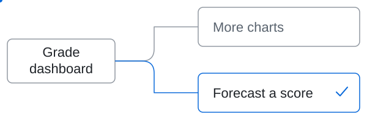

# Shreyas Pabbathi

I build tools for coding agents and experiment with AI in mechanical design.

## Selected work

<a href="https://unlock-labs.pages.dev">
  <picture>
    <source media="(prefers-reduced-motion: reduce) and (prefers-color-scheme: dark)" srcset="https://raw.githubusercontent.com/Shrenzoo/unlock/e57594c713ea4970b399c01c22192290f267dcd3/assets/readme/hero-poster-dark.png">
    <source media="(prefers-reduced-motion: reduce)" srcset="https://raw.githubusercontent.com/Shrenzoo/unlock/e57594c713ea4970b399c01c22192290f267dcd3/assets/readme/hero-poster-light.png">
    <source media="(prefers-color-scheme: dark)" srcset="https://raw.githubusercontent.com/Shrenzoo/unlock/e57594c713ea4970b399c01c22192290f267dcd3/assets/readme/hero-dark.gif">
    
  </picture>
</a>

### UNLOCK

A battery trapped by its own mounting strap. UNLOCK proposes a bounded CAD edit; a separate verifier checks whether the part can come out.

Research prototype, demonstrated on synthetic assemblies. A geometric pass does not establish strength or physical safety.

[Open demo](https://unlock-labs.pages.dev) · [Source](https://github.com/Shrenzoo/unlock) · [Measured evidence](https://github.com/Shrenzoo/unlock#10--measured-evidence)

### Diverge

A creative reasoning skill for Codex and Claude Code. It helps an agent consider alternatives before implementation, while leaving exact fixes alone.

<picture>
  <source media="(prefers-reduced-motion: reduce) and (prefers-color-scheme: dark)" srcset="assets/decision-dark-static.svg">
  <source media="(prefers-reduced-motion: reduce)" srcset="assets/decision-light-static.svg">
  <source media="(prefers-color-scheme: dark)" srcset="assets/decision-dark.svg">
  
</picture>

An example from the project: a student may need to know what score to aim for more than they need another chart.

[Install Diverge](https://github.com/Shrenzoo/diverge#install) · [Decision examples](https://github.com/Shrenzoo/diverge/blob/main/examples/decisions.md) · [Pilot evaluation](https://github.com/Shrenzoo/diverge/blob/main/evals/pilot/README.md)

## Other experiments

**[IncidentBridge](https://github.com/Shrenzoo/incident_bridge)** — Vendor and client agents working through an incident, with redaction and human approval. Hackathon prototype.

**[GoldPal](https://github.com/Shrenzoo/GoldPal)** — A senior-friendly Swift iOS project exploring AI assistance, safety check-ins, and accessible interactions.

## Inside the workshop

I work across Python, TypeScript, and Swift. My current focus: agent tools that make bounded decisions, software that helps people act, and CAD workflows that make products easier to repair.

## A year of building

<picture>
  <source media="(prefers-reduced-motion: reduce) and (prefers-color-scheme: dark)" srcset="assets/contributions-dark-static.svg">
  <source media="(prefers-reduced-motion: reduce)" srcset="assets/contributions-static.svg">
  <source media="(prefers-color-scheme: dark)" srcset="assets/contributions-dark.svg">
  
</picture>

Found something to improve? Open an issue in the project.

Colophon

The CAD animation comes from [UNLOCK](https://github.com/Shrenzoo/unlock), by Shreyas Pabbathi and Maanas Pabbathi. Synthetic fixture and render shared under [CC BY 4.0](https://creativecommons.org/licenses/by/4.0/); reused without modification. The decision sketch illustrates an example documented in [Diverge](https://github.com/Shrenzoo/diverge); rebuild it with `python3 scripts/build_assets.py`.

Contribution animation by [Platane/snk](https://github.com/Platane/snk). Animations have static alternatives for reduced-motion preferences. Design process guided by [unslop by Damir Sokolovsky](https://heydamir.design/unslop), CC BY 4.0.

For updates to this profile, see [the maintenance guide](MAINTAINING.md).

