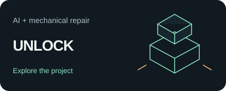
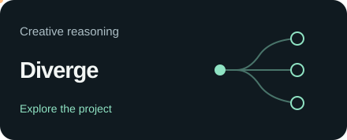
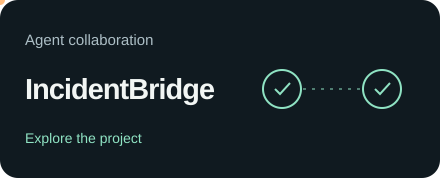
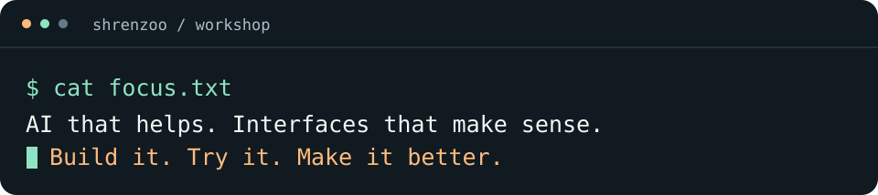

<picture>
  <source media="(prefers-reduced-motion: reduce)" srcset="assets/hero-static.svg">
  
</picture>

  <b>I build AI tools, creative systems, and software that solves practical problems.</b> 
  From helping agents think more creatively to making mechanical assemblies easier to repair.

  <a href="https://unlock-labs.pages.dev"><b>Try UNLOCK</b></a> &nbsp; / &nbsp;
  <a href="https://github.com/Shrenzoo/diverge"><b>Explore Diverge</b></a> &nbsp; / &nbsp;
  <a href="https://github.com/Shrenzoo?tab=repositories"><b>All repositories</b></a>

### Selected work

<a href="https://github.com/Shrenzoo/unlock"><picture><source media="(prefers-reduced-motion: reduce)" srcset="assets/unlock-static.svg"></picture></a>
<a href="https://github.com/Shrenzoo/diverge"><picture><source media="(prefers-reduced-motion: reduce)" srcset="assets/diverge-static.svg"></picture></a>

- **[UNLOCK](https://github.com/Shrenzoo/unlock)** — AI-assisted redesign for mechanical repairability. Bounded CAD edits, checked by an independent geometric verifier. [Try the demo](https://unlock-labs.pages.dev).
- **[Diverge](https://github.com/Shrenzoo/diverge)** — A portable creative reasoning skill for Codex and Claude Code. Explore useful alternatives, then deliver within the constraints. [Install](https://github.com/Shrenzoo/diverge#install).

<a href="https://github.com/Shrenzoo/incident_bridge"><picture><source media="(prefers-reduced-motion: reduce)" srcset="assets/incident-bridge-static.svg"></picture></a>
<a href="https://github.com/Shrenzoo/GoldPal"><picture><source media="(prefers-reduced-motion: reduce)" srcset="assets/goldpal-static.svg"></picture></a>

- **[IncidentBridge](https://github.com/Shrenzoo/incident_bridge)** — A hackathon prototype connecting vendor and client AI agents during an incident, with field-level redaction and human approval.
- **[GoldPal](https://github.com/Shrenzoo/GoldPal)** — A senior-friendly Swift iOS project exploring AI assistance, safety check-ins, and accessible interactions.

### Inside the workshop

<picture>
  <source media="(prefers-reduced-motion: reduce)" srcset="assets/workshop-static.svg">
  
</picture>

**Working with** Python, TypeScript, JavaScript, Swift, React, Next.js, FastAPI, and Three.js.

**Interested in** AI agents, developer tools, accessible software, and the intersection of software and physical design.

### A year of building

<picture>
  <source media="(prefers-reduced-motion: reduce) and (prefers-color-scheme: dark)" srcset="assets/contributions-dark-static.svg">
  <source media="(prefers-reduced-motion: reduce)" srcset="assets/contributions-static.svg">
  <source media="(prefers-color-scheme: dark)" srcset="assets/contributions-dark.svg">
  
</picture>

  Have an idea to improve something here? Open an issue in the project. I’d love to hear it.

About this profile

Original SVG artwork lives in this repository. Rebuild it with `python3 scripts/build_assets.py`. Animations include static alternatives for reduced-motion preferences. The contribution snake is generated daily with [Platane/snk](https://github.com/Platane/snk); no personal access token is required.

Inspired by the [Awesome GitHub Profile README gallery](https://github.com/abhisheknaiidu/awesome-github-profile-readme) and [DenverCoder1’s animated profile](https://github.com/DenverCoder1). The artwork and layout were created for this profile.

